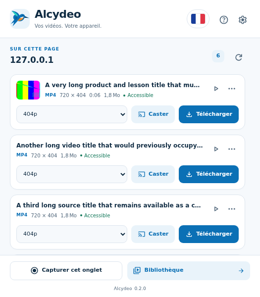
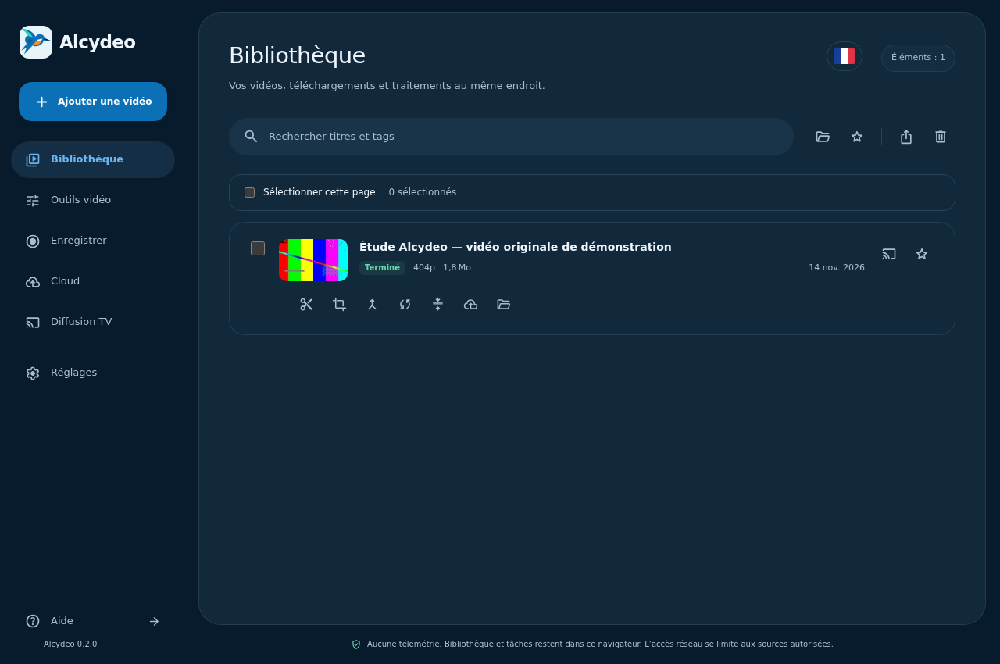
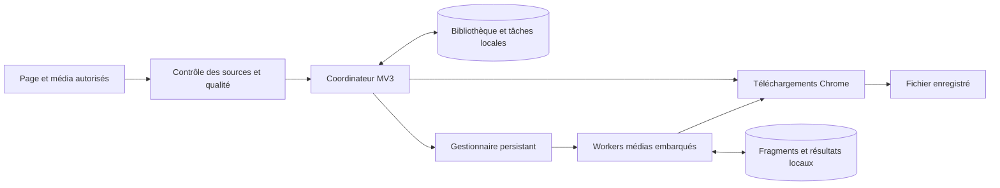

<p align="center">
  <picture>
    <source media="(prefers-color-scheme: dark)" srcset="docs/brand/wordmark-dark.svg">
    
  </picture>
</p>

<p align="center">
  <strong>Vos vidéos. Votre appareil.</strong><br>
  Une extension Chrome gratuite pour repérer les vidéos, choisir leur qualité et les enregistrer.<br>
  Bibliothèque privée et outils vidéo locaux, sans compte Alcydeo ni compagnon.
</p>

<p align="center">
  <a href="https://drslid.github.io/Alcydeo/fr/">Site et guides</a> ·
  <a href="https://github.com/drslid/Alcydeo/releases/tag/v0.2.0">Télécharger la preview</a> ·
  <a href="README.md">English</a> ·
  <a href="LICENSE">Licence MIT</a>
</p>

> [!IMPORTANT]
> **0.2.0 est la première preview publique, pour Chrome desktop uniquement.** La compatibilité dépend des sources, des codecs et du stockage disponible. Les médias protégés sont refusés. Aucune fiche Chrome Web Store n’est encore disponible. Toutes les fonctions développées sont gratuites ; les hébergeurs externes conservent leurs propres limites et conditions.

## Installer la preview

1. Ouvrez la [release v0.2.0](https://github.com/drslid/Alcydeo/releases/tag/v0.2.0) et téléchargez **`alcydeo-0.2.0-chrome.zip`**, plutôt que l’archive automatique « Source code ». Décompressez-la dans un dossier à conserver.
2. Ouvrez `chrome://extensions`, activez le **mode développeur**, choisissez **Charger l’extension non empaquetée**, puis sélectionnez le dossier contenant `manifest.json`.
3. Épinglez Alcydeo, actualisez la page vidéo et lancez la lecture. Ouvrez l’extension, choisissez une qualité disponible et cliquez sur **Télécharger**. **Afficher dans le dossier** retrouve le résultat.

La détection est active par défaut. Chrome demande l’accès HTTP/HTTPS à l’installation ; vous pouvez le restreindre dans Chrome ou suspendre la détection dans Alcydeo. Les propositions ordinaires et leur compteur attendent le contrôle borné d’un préfixe média. Un échantillon accessible ne valide pas tout le fichier.

Vous pouvez fermer la popup. **Gardez le gestionnaire ouvert pour HLS/DASH, les téléchargements en plusieurs parties, l’enregistrement et les outils vidéo.** Fermer Chrome arrête les traitements. La reprise dépend de la source et des checkpoints confirmés. Les Réglages proposent l’enregistrement automatique ou la fenêtre Chrome **Enregistrer sous**.

Pour mettre à jour, attendez la fin des tâches, remplacez les fichiers dans le même dossier puis cliquez sur **Actualiser** dans `chrome://extensions`. Actualisez aussi les pages vidéo. Le CRX n’est pas le parcours d’installation conseillé sur Windows.

<p align="center">
  <picture>
    <source media="(prefers-color-scheme: dark)" srcset="docs/screenshots/popup-sources-fr-dark.png">
    
  </picture>
</p>

*Interface réelle, médias de test originaux ; captures en français.*

## Ce que propose la preview

| Fonction | Périmètre réel |
| --- | --- |
| Détecter et choisir une qualité | Fichiers directs, variantes HLS/DASH contrôlées et catalogues natifs des pages de posts prises en charge ; pas de promesse tous sites |
| Enregistrer un fichier direct | Transfert et confirmation de la copie disque par Chrome ; pause/reprise selon le serveur |
| Assembler des flux | HLS TS/fMP4 non chiffré testé, audio séparé compris, et DASH à une période ; remux et contrôles locaux avant enregistrement |
| Bibliothèque locale | Tâches, favoris, recherche par titre, miniatures réelles, sélection, pagination et export de métadonnées |
| Outils vidéo | Découpe, recadrage visuel, assemblage ordonné, conversion MP4 H.264/AAC et compression ; original conservé, une édition à la fois |
| Enregistrer une lecture | Capture explicite d’onglet WebM ou flux HLS combiné non chiffré compatible vers MP4 ; gestionnaire nécessaire |
| Régler les transferts | 1 à 8 fichiers simultanés, défaut 1 ; option 2/4/8 connexions par fichier compatible, désactivée par défaut ; gain non universel |
| Dix langues | Anglais, espagnol, français, allemand, chinois simplifié, arabe, russe, portugais, hindi, ourdou ; RTL arabe/ourdou |
| Partager volontairement | Gofile, MegaUp, 1fichier, Turbobit et liens de dépôt pCloud ; protocoles testés localement, envois réels non validés |
| Diffuser sur TV | Google Cast web/natif expérimental ; une démo officielle Google confirmée sur Shield par l’utilisateur, sans validation générale des sources ni fichiers privés |

La preview comprend l’**expérimentation YouTube**, les pistes séparées/SABR et les playlists. Des sorties courtes précises ont été enregistrées et décodées ; cela ne valide pas toutes les vidéos, sessions ou playlists complètes. Le paquet Store préparé séparément exclut YouTube à la compilation. [Périmètre YouTube et playlists](docs/PLAYLISTS.md).

<p align="center">
  
</p>

## Des outils locaux, des originaux conservés

Sélectionnez un fichier dans la Bibliothèque ou ouvrez **Outils vidéo** pour découper, recadrer, assembler, convertir ou compresser. Les pistes compatibles sont copiées, les autres pistes prises en charge sont réencodées localement. Une configuration non prise en charge est refusée sans supprimer discrètement le son ou la vidéo. Les résultats conservent le nom réel et ajoutent `-trimmed`, `-cropped`, `-merged`, `-converted` ou `-compressed` avant `.mp4`.

Une copie Chrome peut demander une sélection explicite ou l’accès facultatif aux fichiers. Les sorties conservées par le navigateur sont réutilisables. Aucun scan de dossier ni accès implicite à tous les fichiers du disque. Une interruption fait recommencer l’édition depuis l’entrée conservée, sans prétendre reprendre l’état interne d’un encodeur.

[Découpe](docs/TRIM.md) · [Recadrage](docs/CROP.md) · [Moteur de conversion](docs/ENGINE-DECISION.md) · [Enregistrement et reprise](docs/OUTPUT-SAVING.md)

## TV et cloud : facultatifs, avec leurs limites

**Google Cast** : le lecteur web utilise le SDK Google hors extension. Le récepteur doit accéder lui-même à la source d’origine. L’utilisateur a confirmé une démo officielle Google sur Nvidia Shield ; la réception directe TikTok et les fichiers privés sur Shield restent non validés. Pour un fichier du PC sur Shield, utilisez le lecteur local puis **menu Chrome → Caster → Caster l’onglet**. AirPlay est absent de Chrome Windows. Aucun relais, compagnon ou upload de fichier privé ajouté. [Fonctionnement et preuves TV](docs/TV.md).

**Cloud** : l’envoi commence après **Envoyer**. Gofile, MegaUp, 1fichier et Turbobit produisent des liens de partage ; pCloud utilise un lien de dépôt existant, avec un compte requis pour le propriétaire du dossier. Capacité, rétention et accès dépendent du fournisseur. Les connecteurs expérimentaux ont des tests locaux/interceptés et certaines initialisations réelles, sans revendiquer de transfert réel de fichier. Le nettoyage des temporaires locaux ne supprime ni fichier distant ni original sur disque. [Fournisseurs et confidentialité](docs/CLOUD.md).

## Compatibilité et ressources

- Accès à la source, expiration des signatures, sessions, limites serveur et codecs peuvent empêcher le transfert. Alcydeo signale les refus sans contourner DRM, challenges ou attestations.
- Les fichiers directs passent par Chrome sans chargement intégral en mémoire dans l’extension. Le traitement segmenté peut demander environ **trois fois la taille du média** en stockage temporaire, hors surcoût du système de fichiers. Ce stockage est limité et sa persistance n’est pas garantie.
- DASH multi-périodes, discontinuités/chiffrement non pris en charge et certaines combinaisons codecs/conteneurs sont refusés. Reconnaître une extension de fichier ne garantit pas son édition locale.
- Les essais courts ne prouvent pas une prise en charge universelle de la 8K, des cours longs ou de plusieurs Go. Fixtures, sources publiques, simulations et appareils physiques restent distingués.

[Compatibilité et limites](https://drslid.github.io/Alcydeo/fr/guides/limits/) · [Résultats de tests](docs/TEST-RESULTS.md) · [Contrôles de source](docs/SOURCE-CHECKS.md) · [Parallélisme](docs/DOWNLOAD-CONCURRENCY.md)

## Construire depuis le source

Utilisez **Node 24.22.2** et **pnpm 12.5.1**, avec le lockfile fixé.

```sh
git clone https://github.com/drslid/Alcydeo.git
cd Alcydeo
pnpm install --frozen-lockfile
pnpm build:chrome
```

Chargez `apps/extension/.output/chrome-mv3` avec **Charger l’extension non empaquetée**. L’extension ne demande pas FFmpeg ; les outils éventuels de génération de fixtures servent seulement au développement.

| Commande | Usage |
| --- | --- |
| `pnpm dev:chrome` | Développement extension |
| `pnpm typecheck` / `pnpm lint` | Types et qualité du code |
| `pnpm test` | Tests unitaires/intégration |
| `pnpm test:e2e` / `pnpm test:ci` | Tests de l’extension réelle / sélection CI bornée |
| `pnpm build:chrome` / `pnpm zip:chrome` | Build et ZIP de la preview expérimentale |
| `pnpm zip:store` | Paquet séparé sans YouTube, sans soumission Store |
| `pnpm docs:build` / `pnpm docs:preview` | Build statique / aperçu local du site |
| `pnpm bench` | Mesures médias locales |

Le site Astro/Starlight est statique sous **`/Alcydeo/`**, avec dix routes de langue explicites. Les téléchargements et outils locaux ne demandent aucun backend ni compte. [Développement](docs/DEVELOPMENT.md) · [Tests locaux](docs/LOCAL-TESTING.md) · [Contributions](CONTRIBUTING.md).



## Confidentialité et licence

Aucune télémétrie automatique, publicité ni compte Alcydeo. Les requêtes médias contactent les sources/CDN autorisés ; le partage facultatif contacte le fournisseur choisi. Les URL et signatures temporaires peuvent être conservées localement pour la reprise. Les exports omettent URL, chemins et identifiants de téléchargement. Supprimer une fiche conserve le fichier final et l’historique Chrome. GitHub Pages et les fournisseurs externes ont leurs propres politiques de journalisation. [Confidentialité](docs/PRIVACY.md) · [Sécurité](SECURITY.md).

Code et identité originaux sous [MIT](LICENSE). Les licences tierces sont conservées dans [THIRD_PARTY_NOTICES](THIRD_PARTY_NOTICES.txt), dont les sources MPL-2.0 de Mediabunny, les polices locales SIL OFL et les icônes Material Apache-2.0. Aucun CRX de référence ni code de service propriétaire distribué.

[Notes de version](https://github.com/drslid/Alcydeo/releases) · [Changelog](CHANGELOG.md) · [Ressources graphiques](docs/BRAND.md)
