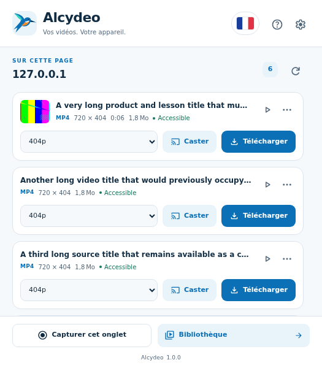
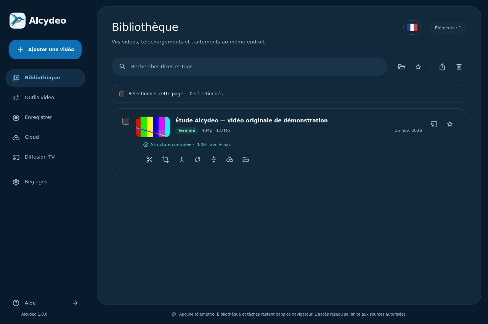
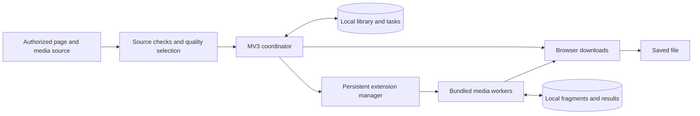

<p align="center">
  <picture>
    <source media="(prefers-color-scheme: dark)" srcset="docs/brand/wordmark-dark.svg">
    
  </picture>
</p>

<p align="center">
  <strong>Your videos. Your device.</strong><br>
  A free desktop extension for Chrome and Firefox to find videos, choose a quality and save them locally.<br>
  A private library and video tools, with no Alcydeo account or companion app.
</p>

<p align="center">
  <a href="https://drslid.github.io/Alcydeo/en/">Website & guides</a> ·
  <a href="https://github.com/drslid/Alcydeo/releases/tag/v1.0.0">Download 1.0.0</a> ·
  <a href="README.fr.md">Français</a> ·
  <a href="LICENSE">MIT license</a>
</p>

> [!IMPORTANT]
> **1.0.0 has separate Chrome and Firefox packages.** Chrome installs unpacked; Firefox installs temporarily until the browser restarts. No Chrome Web Store or Firefox Add-ons listing, signed XPI or Store approval is claimed. Browser features differ; see the [Firefox compatibility guide](docs/FIREFOX.md). All implemented features are free; cloud providers have their own limits and terms.

## Install in Chrome

1. Open [release v1.0.0](https://github.com/drslid/Alcydeo/releases/tag/v1.0.0) and download **`alcydeo-1.0.0-chrome.zip`**. Extract it into a folder you will keep.
2. Open `chrome://extensions`, enable **Developer mode**, choose **Load unpacked**, and select the extracted folder containing `manifest.json`.
3. Pin Alcydeo, refresh the video page and start playback. Open Alcydeo, choose an available quality and select **Download**. **Show in folder** finds the saved result.

Detection is enabled by default. Chrome requests HTTP/HTTPS site access at installation; you can restrict it in Chrome or pause detection in Alcydeo. Ordinary proposals and the badge wait for a bounded media-prefix check. A successful sample confirms a source, rather than every byte of a complete file.

The popup can close while work continues. **Keep the manager open during HLS/DASH, multipart downloads, recording and editing.** Closing the browser stops processing. Pause/recovery depends on the source and confirmed local checkpoints. Automatic saving and the browser's **Save As** dialog are selectable in Settings.

For updates, replace the files in the same unpacked-extension folder, select **Reload** in `chrome://extensions`, and refresh video pages. Wait for active work to finish first. A packaged CRX is not the recommended Windows installation route.

## Install temporarily in Firefox

Use **Firefox 153 or later**. Download **`alcydeo-1.0.0-firefox.zip`** from the same Release. Open `about:debugging#/runtime/this-firefox`, choose **Load Temporary Add-on…**, and select the ZIP, or extract it and select `manifest.json`. This development installation ends when Firefox restarts. A permanent installation in regular Firefox requires Mozilla signing; renaming the ZIP to `.xpi` does not sign it. [Mozilla's installation guide](https://extensionworkshop.com/documentation/develop/temporary-installation-in-firefox/).

The Firefox package excludes YouTube, as does the separate Chrome Store preparation. **`alcydeo-1.0.0-source.zip`** contains review sources and build instructions; GitHub's automatic “Source code” download is also source, not a compiled extension. See [Firefox scope and validation](docs/FIREFOX.md) before choosing a browser.

Real Firefox **160.0 and ESR 153.7.0** tests save direct/HLS/DASH files and exercise conversion, crop, compression, trim and merge with the OS media codecs available. Local editing depends on those browser/OS codecs. Firefox has no Chrome tab capture, Google Cast or AirPlay; a missing codec must not produce a false saved file.

New installations and a settings reset allow **four simultaneous files**, with multipart enabled at **four connections per compatible file**. Existing saved choices are preserved. Both limits remain adjustable; server access and connection limits still apply.

The local detection diagnostic is in **Library → Settings → Detection**, where you choose the source tab and inspect or copy the report. It contains safe codes/counters and has no automatic upload. The popup stays focused on sources and downloads.

<p align="center">
  <picture>
    <source media="(prefers-color-scheme: dark)" srcset="docs/screenshots/popup-sources-fr-dark.png">
    
  </picture>
</p>

*Real interface, original synthetic test media; screenshots are in French.*

## What you can do

| Capability | Supported scope and limits |
| --- | --- |
| Find media and choose its quality | Direct files, checked HLS/DASH variants and native catalogs for supported post pages; no universal site promise |
| Save direct files | The browser handles the transfer and confirms the saved disk copy; pause/resume depends on the server |
| Assemble segmented media | Tested unencrypted HLS TS/fMP4, including separate audio, and single-period DASH; local remux, output checks and saving |
| Manage a local library | Downloads, favorites, title search, real thumbnails, selection, pagination and metadata export |
| Edit videos locally | Trim, visual crop, ordered merge, H.264/AAC MP4 conversion and compression; originals kept, one edit at a time |
| Record | Chrome tab capture to WebM, or supported unencrypted combined HLS streams to MP4; manager required; browser differences in the Firefox guide |
| Control concurrency | 1–8 files, default 4; 2/4/8 connections per compatible file, enabled at 4 for new/reset settings. No universal speed gain |
| Use your language | English, Spanish, French, German, Simplified Chinese, Arabic, Russian, Portuguese, Hindi and Urdu; RTL for Arabic/Urdu |
| Share voluntarily | Gofile, MegaUp, 1fichier, Turbobit and pCloud upload links. Local protocol tests; real-provider uploads remain unvalidated |
| Cast | Experimental Google Cast web/native paths. One official Google demo on Shield was confirmed by the user; other media and private files are not validated by that result |

The Chrome development package includes **experimental YouTube detection, separate tracks/SABR and playlists**. Specific short outputs were saved and decoded; this does not validate every video, session or complete playlist. The Chrome Store preparation and Firefox package exclude YouTube at compilation. See [YouTube and playlists](docs/PLAYLISTS.md).

<p align="center">
  
</p>

## Local tools, original files kept

Select a library file or open **Video tools** to trim, crop, merge, convert or compress. Supported compatible tracks are copied; other supported tracks are encoded locally. A tool refuses unsupported configurations rather than silently dropping audio or video. Results keep the original name and add `-trimmed`, `-cropped`, `-merged`, `-converted` or `-compressed` before `.mp4`.

Native files can require explicit file selection or optional Chrome file access. Retained browser outputs can be reused. No folder scan or implicit access to arbitrary disk files is required. Interruption restarts editing from the retained input, rather than pretending to resume an encoder’s internal state.

[Trimming](docs/TRIM.md) · [Crop](docs/CROP.md) · [Conversion engine](docs/ENGINE-DECISION.md) · [Saving and recovery](docs/OUTPUT-SAVING.md)

## TV and cloud: optional, with limits

**Google Cast (Chrome):** the web sender uses Google’s SDK outside the extension. A receiver must access the original source itself. The user reported playback of one official Google demo on Nvidia Shield; direct TikTok reception and private-file transport to Shield remain unvalidated. For private PC files on Shield, use the local player and **Chrome menu → Cast → Cast tab**. AirPlay is unavailable in Chrome on Windows. Firefox does not gain Chrome's Cast APIs from this port. No relay, companion or private-file upload is added. [TV guide and evidence](docs/TV.md).

**Cloud:** sending begins only after **Send**. Gofile, MegaUp, 1fichier and Turbobit return sharing links; pCloud needs an existing upload link, with an account required for its folder owner. Providers control capacity, retention and access. The experimental connectors have intercepted/local protocol tests and some real initialization checks, without real-file uploads being claimed. Local cloud temporary-file cleanup does not delete a remote file or disk original. [Provider details and privacy](docs/CLOUD.md).

Firefox additionally requests native optional consent for sending file contents and any personal data they may contain, such as voice or image. Refusing prevents preparation and sending; it does not enable telemetry.

## Compatibility and resources

- Media source access, signed-URL expiry, cookies, server rate limits and codecs can prevent a download. Alcydeo reports refusals; it does not bypass DRM, access challenges or attestations.
- Direct downloads use the browser's download manager without loading the complete video into extension memory. Segmented processing can need roughly **three times the media size** in temporary storage, plus overhead. Browser storage is finite and not guaranteed durable.
- Multi-period DASH, unsupported discontinuities/encryption and untested codec/container combinations are refused. Recognizing a file extension does not guarantee that the local editor can decode it.
- Short-file tests do not establish universal 8K, long-course or multi-GB performance. Tests against fixtures, public sources, receiver simulations and physical devices are reported separately.

[Compatibility and limits](https://drslid.github.io/Alcydeo/en/guides/limits/) · [Test evidence](docs/TEST-RESULTS.md) · [Source checks](docs/SOURCE-CHECKS.md) · [Concurrency](docs/DOWNLOAD-CONCURRENCY.md)

## Build from source

Use **Node 24.22.2** and **pnpm 12.5.1**, with the pinned lockfile.

```sh
git clone https://github.com/drslid/Alcydeo.git
cd Alcydeo
pnpm install --frozen-lockfile
pnpm build:chrome
```

Load `apps/extension/.output/chrome-mv3` through **Load unpacked**. The extension does not run a separate FFmpeg executable; Firefox uses its browser/OS codecs. Optional fixture-generation tools are development-only.

| Command | Purpose |
| --- | --- |
| `pnpm dev:chrome` | Extension development |
| `pnpm typecheck` / `pnpm lint` | Type and code checks |
| `pnpm test` | Unit/integration tests |
| `pnpm test:e2e` / `pnpm test:ci` | Actual extension browser tests / bounded CI selection |
| `pnpm build:chrome` / `pnpm zip:chrome` | Build and package the Chrome development channel |
| `pnpm zip:store` | Prepare the separate package excluding YouTube; no Store submission |
| `pnpm build:firefox` / `pnpm zip:firefox` | Dedicated Firefox channel excluding YouTube |
| `pnpm zip:source` | Review source archive from the reviewed Git commit |
| `pnpm docs:build` / `pnpm docs:preview` | Static website build / local preview |
| `pnpm bench` | Local media measurements |

The site is Astro/Starlight, static under **`/Alcydeo/`**. All ten languages have explicit routes. No backend or account service is required for local downloads and editing. See [development](docs/DEVELOPMENT.md), [local testing](docs/LOCAL-TESTING.md) and [contributing](CONTRIBUTING.md).



## Privacy and license

No automatic telemetry, advertising or Alcydeo account. Media requests reach the allowed source/CDN; optional sharing reaches the selected provider. Task URLs and temporary signatures may be retained locally for recovery. Metadata exports omit URLs, paths and download IDs. Removing a library record keeps saved disk files and the browser's own download history. GitHub Pages and external providers have their own logging policies. [Privacy](docs/PRIVACY.md) · [Security](SECURITY.md).

Original code and original visual assets are [MIT](LICENSE). Third-party licenses remain in [THIRD_PARTY_NOTICES](THIRD_PARTY_NOTICES.txt), including Mediabunny’s MPL-2.0 source, local SIL OFL fonts and Apache-2.0 Material icons. No reference CRX or proprietary service code is distributed.

[Release notes](https://github.com/drslid/Alcydeo/releases) · [Changelog](CHANGELOG.md) · [Brand assets](docs/BRAND.md)
