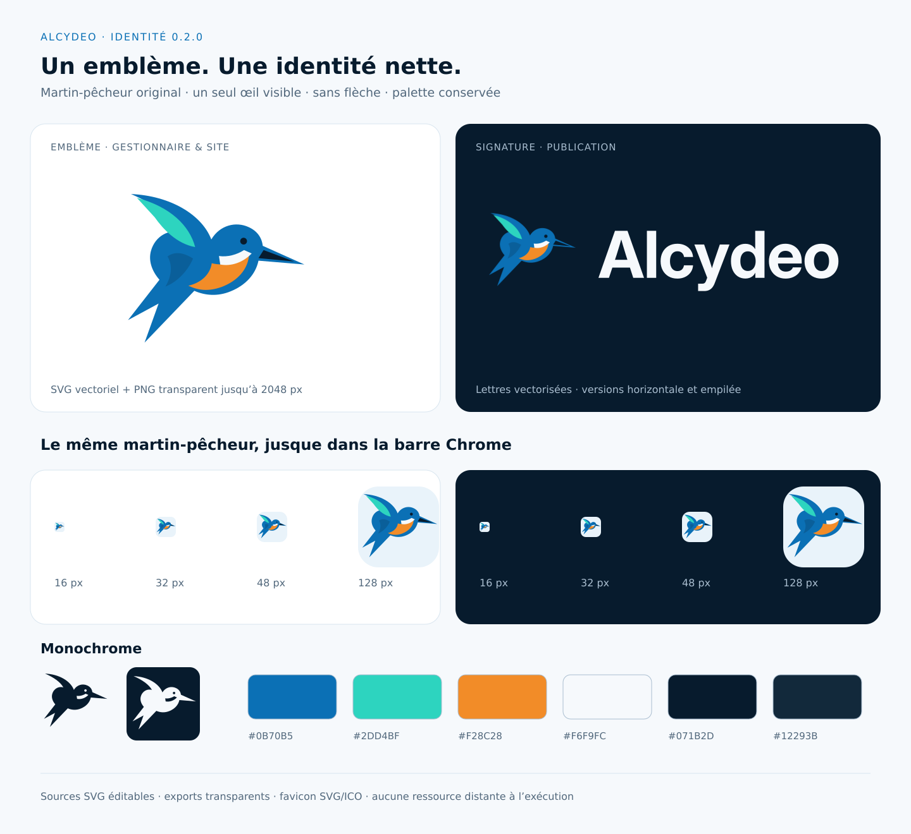

# Alcydeo — identity kit 0.2.0

**Le Plongeon** is an original, minimal kingfisher emblem. Its long beak, swept wing, single visible eye and orange breast make the bird identifiable without a download arrow. The blue, turquoise and orange palette is retained. The premium direction describes the visual finish; Alcydeo remains free.

The November 14, 2026 request permits a new drawing in place of the earlier cartoon. Three original vector directions are kept in [the proposal board](brand/proposals/board.png): Le Plongeon (recommended and used), L’Atelier (a softer character) and Alcyon (an A monogram). These are alternatives, not three competing product marks.

| Use | Files under `docs/brand` |
| --- | --- |
| Product, manager and website | `kingfisher.svg` |
| Transparent high resolution artwork | `kingfisher.png`, `kingfisher-1024.png`, `kingfisher-2048.png` |
| Toolbar and favicon | `kingfisher-icon.svg`, `icon-16.png`, `icon-32.png`, `icon-48.png`, `icon-128.png`, SVG/ICO favicon |
| Horizontal signature | `wordmark.svg`, `wordmark-dark.svg` and 2400 px PNG exports |
| Stacked signature | `lockup-stacked.svg`, `lockup-stacked-dark.svg` and PNG exports |
| Communication artwork | `social-light.svg`, `social-dark.svg` and 3200 × 1800 PNG exports |
| One-color printing | `kingfisher-mono.svg`, `mono-light.svg`, `mono-dark.svg` and PNG exports |

The **same complete emblem** supplies every icon. Edit only `packages/design-tokens/brand/kingfisher.svg`; `scripts/brand.mjs` extracts its `canonical-mark` group and shared silhouette. There is no independently drawn face. Monochrome keeps that silhouette and uses the original eye and throat as negative space.

Use SVG wherever possible. The artwork is transparent, without an external white outline. Toolbar PNGs and the favicon have a pale rounded tile for contrast in either Chrome theme; this tile is separate from the bird. Large signatures remain transparent. Keep the aspect ratio, clear space and orientation in RTL layouts. Do not add a crown, arrow, bevel or an extra face.

Generate all exports with `node scripts/brand.mjs`, and the downloadable kit with `pnpm zip:brand`. The source emblem and proposals are original MIT artwork. Wordmark letters are outlined from Inter Bold under SIL OFL 1.1; their pinned source and hash remain in `packages/design-tokens/brand/PROVENANCE.json`. No external font or image service runs in the product. Material Symbols interface icons have their own Apache-2.0 license.

Design research: [Pentagram / Vertical](https://www.pentagram.com/work/vertical) demonstrates a simplified bird silhouette; [Pentagram / Hiut](https://www.pentagram.com/work/hiut) demonstrates careful animal proportions and a coherent identity system. These are references for principles only. Their logos, paths, lettering and assets are not copied or redistributed.
